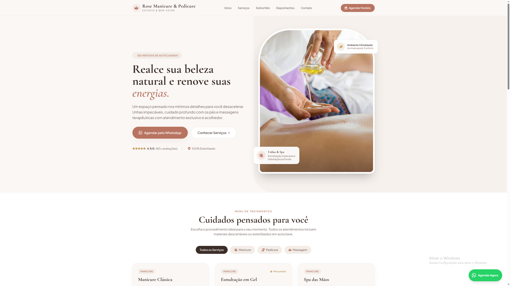

# 💅 Rose Manicure & Pedicure – Estúdio & Bem-Estar

Landing Page responsiva desenvolvida para o estúdio **Rose Manicure & Pedicure**, com o objetivo de fortalecer a presença digital do negócio, apresentar o catálogo de tratamentos e otimizar o agendamento de clientes via WhatsApp.

> **Contexto Acadêmico:** Projeto prático desenvolvido como parte do **Projeto de Extensão II (PEX II)** do curso de Engenharia de Software (Descomplica UniAmérica), alinhado à **ODS 8 (Trabalho Decente e Crescimento Econômico)** da ONU.

---

## 🖼️ Prévia do Projeto



---

## 🎯 Funcionalidades e Diferenciais

* **Catálogo Interativo de Serviços:** Separação clara entre categorias (*Todos os Serviços, Manicure, Pedicure e Massagem*).
* **Conversão Direta (CTA):** Botões estratégicos que direcionam o cliente diretamente para o WhatsApp comercial do estúdio.
* **Prova Social e Biossegurança:** Destaque visual para avaliações de clientes (`4.9/5`) e protocolos de esterilização (`100% Esterilizado`).
* **Design Responsivo:** Layout adaptado para dispositivos móveis e desktops.

---

## 🛠️ Tecnologias e Ferramentas Utilizadas

* **HTML5:** Estruturação semântica do conteúdo.
* **CSS3:** Estilização, paleta de cores acolhedora e responsividade.
* **Figma:** Prototipação de interface (UI) e experiência do usuário (UX).
* **VSCode:** Ambiente de desenvolvimento.
* **Git & GitHub:** Controle de versão e hospedagem do código.

---

## 💡 Decisão Arquitetural

Optou-se por uma arquitetura **Front-End estática (sem Back-End ou banco de dados)**. Como o objetivo central é a vitrine de serviços e o redirecionamento para atendimento humano, essa abordagem garante:
1. **Custo zero** de manutenção e hospedagem para a microempreendedora (MEI).
2. **Alta performance** e carregamento rápido em redes móveis.
3. **Conformidade com a LGPD**, uma vez que nenhum dado sensível dos clientes é armazenado na plataforma.

---

## 🚀 Como visualizar o projeto

1. Clone este repositório:
   ```bash
   git clone [https://github.com/](https://github.com/)Matthew8717/Pex-II---Descomplica-Faculdade.git

2. Abra a pasta do projeto no VSCode.

3. Execute o arquivo index.html diretamente no navegador ou utilizando a extensão Live Server.

---

## 👨‍💻 Autor
Desenvolvido por Matthew8717 com a ajuda do Gemini do Google.

Estudante de Engenharia de Software – Descomplica UniAmérica
